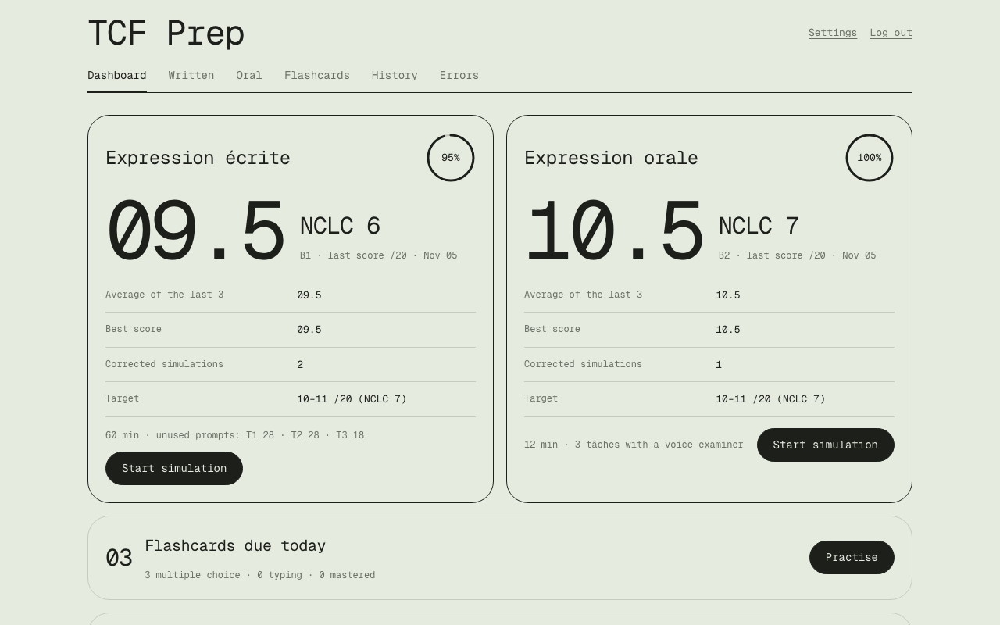
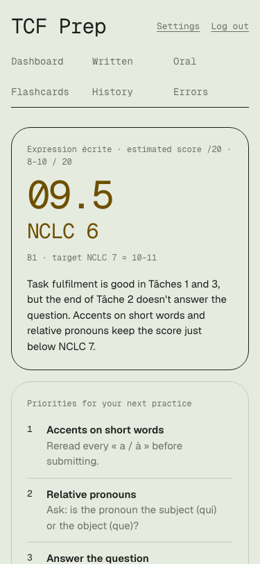

# TCF Prep

[](https://github.com/arturramosc99/tcf-prep/actions/workflows/ci.yml)

Practise the **TCF Canada** *Expression écrite* and *Expression orale* in exam conditions, get every text and
every spoken answer corrected by AI, and turn your recurring mistakes into flashcards.

Free and open source. You run your own copy (free on Vercel + Neon) and pay the AI providers directly for what
you use — about US$0.10–0.20 per written correction.

<p>
  
  
</p>

## What it does
- **Written (Expression écrite):** the 3 tâches in 60 minutes, typed as on exam day, with a word counter and accent
  keys. Prompts come from an original bank; when you've used them all, Claude writes new ones. You can also paste
  a prompt you found elsewhere.
- **Oral (Expression orale):** the 3 tâches in 12 minutes with an AI examiner that talks to you (OpenAI Realtime):
  a directed interview that may cut you off, a role-play where you ask the questions, and a monologue.
- **Corrections (Claude):** a score out of 20, your NCLC and CEFR level, task fulfilment first, every error with the
  rule, a minimally corrected version and a B2+ rewrite of *your own* text.
- **Recurring errors:** mistakes are grouped into patterns with a status (critical → resolved) computed over your
  last sessions, and fed back into the next correction.
- **Flashcards:** your mistakes become cards automatically, from multiple choice to typing from scratch, with spaced
  repetition. No AI, no cost.
- **Works on your phone**, light and dark mode. A setup guide walks you through API credits and keys.

Scores are estimates to guide your practice, not official results. Not affiliated with France Éducation
International.

## Install your own copy
**Follow [docs/install.md](docs/install.md)** — about 20 minutes, no coding: fork on GitHub, import into Vercel,
add a secret, connect a Neon database, open your app. You'll need a payment card for the AI credits
([costs and keys](docs/api-keys.md)).

Prefer to be guided? Paste this into any AI assistant (ChatGPT, Claude, Gemini…):

> I want to install TCF Prep. Read https://github.com/arturramosc99/tcf-prep/blob/main/AGENTS.md and
> https://github.com/arturramosc99/tcf-prep/blob/main/docs/install.md and guide me one step at a time.
> I'm not technical. Never ask me to paste passwords or keys into this chat.

One-click alternative (quicker, but updates are manual — see [updating](docs/updating.md)):

[](https://vercel.com/new/clone?repository-url=https%3A%2F%2Fgithub.com%2Farturramosc99%2Ftcf-prep&project-name=tcf-prep&repository-name=tcf-prep&env=SESSION_SECRET&envDescription=A%20long%20random%20secret%20(40%2B%20characters)%20that%20protects%20your%20login%20and%20API%20keys.%20Save%20it%20in%20your%20password%20manager.&envLink=https%3A%2F%2Fgithub.com%2Farturramosc99%2Ftcf-prep%2Fblob%2Fmain%2Fdocs%2Finstall.md%23session-secret&stores=%5B%7B%22type%22%3A%22integration%22%2C%22integrationSlug%22%3A%22neon%22%2C%22productSlug%22%3A%22neon%22%2C%22protocol%22%3A%22storage%22%7D%5D)

## Costs
| | Typical cost |
| --- | --- |
| Written correction (Claude) | ~US$0.10–0.20 |
| Oral simulation (OpenAI voice, 12 min) | ~US$1–3, depending on how much you speak |
| Oral correction (Claude) | ~US$0.10–0.20 |
| Flashcards | free |
| Hosting (Vercel Hobby + Neon Free) | free for one person |

## Security and privacy
One user per install: your data lives in your own database. Your password is hashed, your API keys are encrypted
and only used by your server, and the browser never sees them. Details in [SECURITY.md](SECURITY.md).

## Develop
```bash
npm ci
npm run dev        # http://localhost:3000, local database, no keys needed
npm test           # unit + end-to-end tests, offline (fake Anthropic/OpenAI)
```
Read [AGENTS.md](AGENTS.md) first — it's written for humans and for AI coding assistants (Codex, Claude Code,
Cursor…). More: [local development](docs/local-development.md), [architecture](docs/architecture.md),
[QA checklist](docs/qa/checklist.md), [contributing](CONTRIBUTING.md).

## License
[MIT](LICENSE), including the original prompt bank in `data/consignes/bank.json`.
